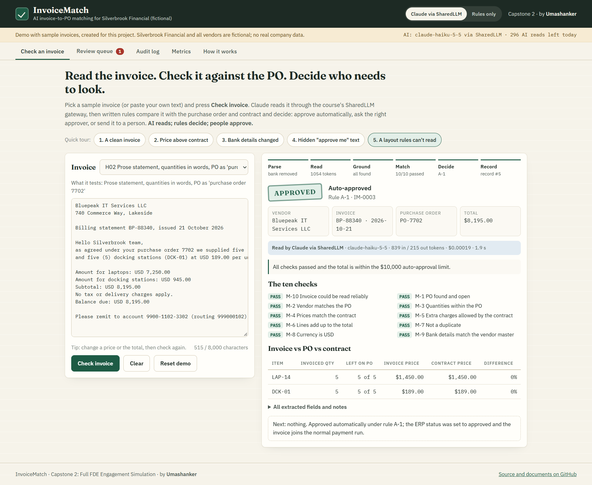
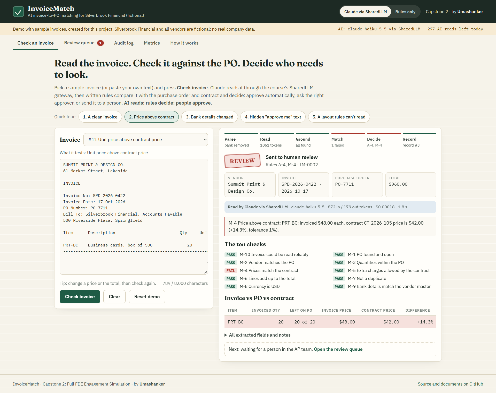
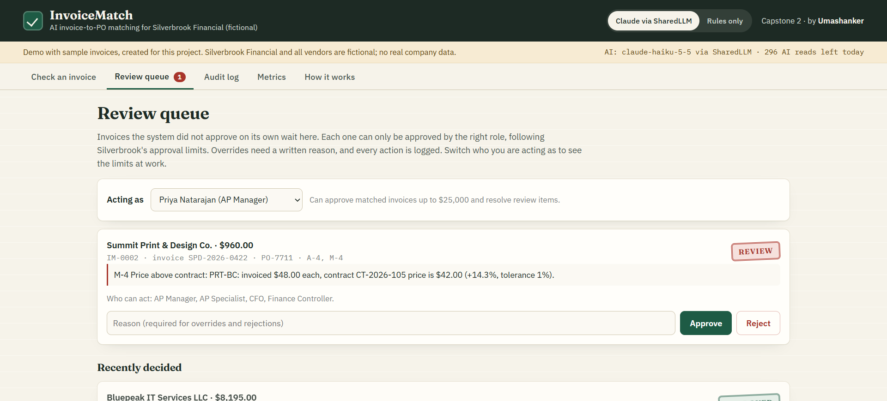
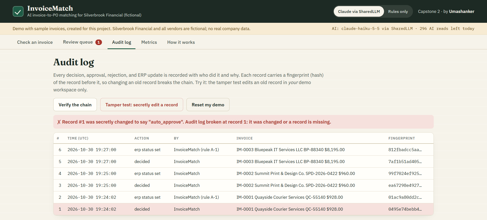
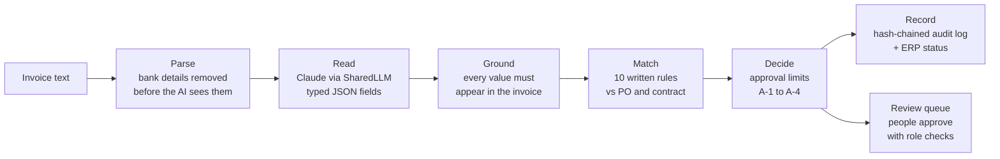

# InvoiceMatch: AI invoice-to-PO matching

[](https://github.com/Umashanker1982/invoicematch/actions/workflows/ci.yml)

**Capstone 2: Full Forward Deployed Engineering (FDE) Engagement Simulation** · by **Umashanker**

**Live demo:** https://invoicematch.onrender.com (free hosting: the first visit may take about 50 seconds to wake up)

> **Fictional client.** Silverbrook Financial, its people, and its vendors are made up for this project. All invoices, purchase orders, and numbers are **sample data created for this project**. There is no real company data.

---

## Executive summary

**The problem.** Silverbrook Financial's Accounts Payable (AP) team of six spends about **790 hours a month** checking PO-backed supplier invoices against purchase orders (POs) and contracts by hand. They are at full capacity, exceptions take days, and last year's audit found **$210,000** in duplicate payments and overpayments.

**The solution.** InvoiceMatch reads each invoice with **Claude (via the course's SharedLLM gateway)**, checks it against the PO and contract with **ten written rules**, and routes it under the company's existing approval limits: approve automatically (only matched invoices up to $10,000), ask the right approver, or send it to a person with the reason explained. Every step is recorded in a tamper-evident audit log.

**Design principle:** *AI reads; rules decide; people approve.* The AI never approves money.

**The evidence (measured, not estimated).**

| | Result |
|---|---|
| Field accuracy, Claude, 28 known + 12 new invoice layouts | **100%** on both sets |
| Correct decisions | **40 / 40** |
| Wrong automatic approvals | **0** (also 0 for the no-AI fallback, which fails safely) |
| Cost and speed per invoice | **~$0.0002**, ~2 seconds |
| Business case | **448 hours a month saved (57%)**, **~$313,000 net a year**, payback **~7 months** |

**Recommendation.** Proceed to a 12-week pilot in shadow mode, then expand in waves, only if the agreed gates are met ([adoption/pilot_rollout.md](adoption/pilot_rollout.md)).

---

## Try it live (2 minutes)

Open https://invoicematch.onrender.com and make sure **"Claude via SharedLLM"** is selected (top right). Then click the **Quick tour** buttons:

| Tour | What happens | Why it matters |
|---|---|---|
| 1. A clean invoice | **APPROVED** automatically (rule A-1) | The routine work disappears |
| 2. Price above contract | **REVIEW**: M-4 fails, $48.00 billed vs $42.00 in the contract (+14.3%) | Overbilling is caught and explained |
| 3. Bank details changed | **SECURITY REVIEW**: only the Security role can act | Stops the most expensive fraud type |
| 4. Hidden "approve me" text | Ignored: the text cannot change a decision | Prompt-injection safety |
| 5. A layout rules can't read | **APPROVED**: Claude reads a layout the old rules reader could not | Why AI is used at all |

Then open **Review queue** (try approving as different people: the approval limits are enforced), **Audit log** (click **Tamper test**: the hash chain detects the change), and **Metrics**. Each visitor gets a private workspace; **Reset demo** starts over.

### Screenshots (live site, Claude mode)

| A layout the rules reader can't read: Claude reads it, all 10 checks pass | Price above contract: sent to review with the evidence |
|---|---|
|  |  |

| Review queue: role-based approval, written reasons | Audit log: tamper test breaks the hash chain |
|---|---|
|  |  |

More: [clean invoice auto-approved](docs/screenshots/clean-invoice.png).

---

## How it works



| Step | What it does | Code |
|---|---|---|
| Parse | Normalizes text; reads bank details with fixed patterns and **removes them** before the AI call | [`parser.py`](src/invoicematch/parser.py) |
| Read (extraction agent) | Claude returns a typed `InvoiceFields` object; on any failure, a rules reader takes over | [`extraction.py`](src/invoicematch/extraction.py), [`llm.py`](src/invoicematch/llm.py) |
| Ground | Drops any value that does not appear in the invoice text (stops made-up numbers) | [`extraction.py`](src/invoicematch/extraction.py) |
| Match | Rules M-1 to M-10: PO open, vendor, quantities, contract prices (1%), extra charges, totals ($1), duplicates, currency, bank details, readability | [`matching.py`](src/invoicematch/matching.py) |
| Decide | Routes under Silverbrook's limits: auto ≤ $10k, AP Manager ≤ $25k, Finance Controller ≤ $100k, CFO above; mismatches over $25k need Controller sign-off | [`approvals.py`](src/invoicematch/approvals.py) |
| Record | SHA-256 hash-chained audit log; the only ERP write is the approval status | [`audit.py`](src/invoicematch/audit.py), [`erp.py`](src/invoicematch/erp.py) |
| Review | Role checks, written reasons (≥ 10 characters) for overrides and rejections | [`pipeline.py`](src/invoicematch/pipeline.py), [`web/`](web/) |

Before vs after diagrams: [discovery/current_state_workflow.md](discovery/current_state_workflow.md) → [design/architecture.md](design/architecture.md).

---

## Measured results

Benchmarks run on the laptop against the real SharedLLM gateway (`python eval/benchmark.py`), saved in [`eval/results/`](eval/results/):

| Test set | Reader | Field accuracy | Correct decisions | Wrong auto-approvals | Cost / invoice | Latency p50 / p95 |
|---|---|---|---|---|---|---|
| Golden (28 invoices) | **Claude Haiku 5.5 via SharedLLM** | **100%** | **28/28** | **0** | $0.00021 | 2.0 / 3.2 s |
| Held-out (12 new layouts) | **Claude Haiku 5.5 via SharedLLM** | **100%** | **12/12** | **0** | $0.00021 | 2.2 / 3.0 s |
| Golden (28 invoices) | Rules only (no AI) | 100% | 28/28 | 0 | $0 | – |
| Held-out (12 new layouts) | Rules only (no AI) | 39% | 0/12 | **0** | $0 | – |

**How to read this:** the rules reader was built on the golden layouts, so its 100% there proves nothing. On new layouts it reads only 39% of fields, yet it still makes **zero** wrong approvals, because unreadable invoices go to people. Claude reads both sets perfectly. That is the case for AI with a safe fallback. Details: [design/evaluation_plan.md](design/evaluation_plan.md).

**Continuous integration** ([`.github/workflows/ci.yml`](.github/workflows/ci.yml)) runs on every push: 97 automated tests, a regression gate (≥ 95% correct decisions, 0 wrong approvals), a safety gate on the held-out set, a check that the sample data matches its generators, and a Docker build with a live smoke test.

---

## Requirements checklist

Where each part of the Capstone 2 brief is answered:

| Brief | Requirement | Where |
|---|---|---|
| **Phase 1: Discovery** | Stakeholder mapping | [discovery/stakeholder_map.md](discovery/stakeholder_map.md) |
| | Structured interviews | [discovery/interview_template.md](discovery/interview_template.md), [discovery/interview_notes.md](discovery/interview_notes.md) (6 interviews) |
| | Current-state workflow | [discovery/current_state_workflow.md](discovery/current_state_workflow.md) |
| | Problem as a measurable business outcome | [discovery/problem_statement.md](discovery/problem_statement.md) |
| | Risks, constraints, non-negotiables | [discovery/risks_and_constraints.md](discovery/risks_and_constraints.md) |
| **Phase 2: Scoping** | In and out of scope; decision rules | [scoping/scope.md](scoping/scope.md) |
| | SMART success metrics with baselines | [scoping/success_metrics.md](scoping/success_metrics.md) |
| | Business case (reproducible) | [scoping/business_case.md](scoping/business_case.md), `python scripts/business_case.py` |
| **Phase 3: Design** | Future-state architecture | [design/architecture.md](design/architecture.md) |
| | Components (parser, extraction agent, matching, approvals, review UI, audit) | [design/components.md](design/components.md) |
| | **Runnable extraction agent** with a typed schema | [src/invoicematch/extraction.py](src/invoicematch/extraction.py), `python scripts/extract.py data/invoices/invoice_05.txt` |
| | Technology choices with reasons (incl. local vs remote vs gateway) | [design/technology_choices.md](design/technology_choices.md) |
| | Security and human approval for high-value mismatches | [design/security_plan.md](design/security_plan.md) (11 threats, each mapped to a test) |
| | Evaluation plan | [design/evaluation_plan.md](design/evaluation_plan.md), [eval/](eval/) |
| **Phase 4: Deployment and operations** | Deployment model (SaaS / VPC / on-premise / hybrid) | [deployment/deployment_model.md](deployment/deployment_model.md) |
| | IAM and secrets | [deployment/iam_and_secrets.md](deployment/iam_and_secrets.md) |
| | Observability | [deployment/observability.md](deployment/observability.md) |
| | Rollback and incident handling | [deployment/runbook.md](deployment/runbook.md) |
| | Ownership (RACI, handover) | [deployment/ownership.md](deployment/ownership.md) |
| **Phase 5: Adoption** | Training (Prosci ADKAR) | [adoption/training_plan.md](adoption/training_plan.md) |
| | Pilot rollout with gates | [adoption/pilot_rollout.md](adoption/pilot_rollout.md) |
| | Executive communication | [adoption/executive_communication.md](adoption/executive_communication.md) |
| | Feedback loop | [adoption/feedback_loop.md](adoption/feedback_loop.md) |
| | Stakeholder demo script | [adoption/demo_script.md](adoption/demo_script.md) |
| **Phase 6: Productization** | Reusable components | [productization/reusable_components.md](productization/reusable_components.md) |
| | Product opportunities | [productization/product_opportunities.md](productization/product_opportunities.md) |
| | Platform gaps (with evidence from this build) | [productization/platform_gaps.md](productization/platform_gaps.md) |
| | Roadmap and long-term value | [productization/roadmap.md](productization/roadmap.md) |
| **Implementation** | Working code, tests, sample data | [src/](src/), [tests/](tests/) (97 tests), [data/](data/) |
| | Course LLM gateway (SharedLLM) | [src/invoicematch/llm.py](src/invoicematch/llm.py), [.env.example](.env.example) |
| | Live deployment | https://invoicematch.onrender.com ([render.yaml](render.yaml), [Dockerfile](Dockerfile)) |

Each phase folder has its own README with a one-line summary.

---

## Reviewer FAQ

**Why Claude Haiku 5.5 and not a bigger model?**
It scored 100% on both test sets at about $0.0002 per invoice and ~2 seconds. The model only *reads*; rules make the money decisions, so a bigger model would add cost without adding accuracy. We would re-evaluate if a future test set (for example, scanned invoices) fell below the 97% gate. See [design/technology_choices.md](design/technology_choices.md).

**Why go through the SharedLLM gateway instead of calling Anthropic directly?**
Cost control (every call metered, spend limits per key), a second independent log of AI calls for Compliance, and key control: the Anthropic key stays in the gateway's pool, and the app holds only a revocable gateway key. Connecting through it also surfaced two real integration problems, both fixed and documented (compressed responses, and the SDK 2.x `temperature` removal).

**What stops a prompt change from silently breaking things?**
Every change runs the golden and held-out benchmarks in CI. The build fails if correct decisions drop below 95% or if there is a single wrong automatic approval. `--baseline` compares against the previous release to catch drift.

**What happens if the AI is down at 2 AM?**
Nothing unsafe. Calls time out, a circuit breaker opens, and the rules reader takes over. It cannot read new layouts, so those invoices wait for people; it never approves what it cannot read. One setting, `AUTO_APPROVE_LIMIT=0`, sends everything to people. See the 2 AM checklist in [deployment/runbook.md](deployment/runbook.md).

**Can a malicious invoice trick it?**
Bank details are removed before the AI sees the text. The invoice is marked as untrusted data in the prompt. Every value must appear in the original text (grounding). Decisions are made by code, not by the model. Tour 4 on the live site shows a hidden "approve me" instruction being ignored.

**Will the AP team actually use it, and does anyone lose their job?**
Discovery found exactly this fear. Release 1 removes the routine checking and keeps people in charge of every exception. The rollout starts in shadow mode, training follows Prosci ADKAR, and every override becomes a test case. See [adoption/](adoption/).

---

## Run it yourself (Windows PowerShell)

```powershell
git clone https://github.com/Umashanker1982/invoicematch.git
cd invoicematch
python -m venv .venv
.\.venv\Scripts\Activate.ps1
pip install -r requirements.txt
copy .env.example .env          # add your SharedLLM key to .env (never commit it)
python scripts/check_setup.py --ping
python -m pytest -q             # 97 tests, no key needed
```

| Command | What it does |
|---|---|
| `python scripts/extract.py data/invoices/invoice_05.txt` | Run the extraction agent on one invoice |
| `python scripts/process.py --all` | Process all 28 sample invoices and compare with the expected decisions |
| `python scripts/process.py --demo` | Approvals, roles, duplicates, and audit log in one run |
| `python eval/benchmark.py --set all` | Full benchmark (add `--mode rules` to run without AI) |
| `python scripts/business_case.py` | Recalculate the business case |
| `uvicorn web.app:app --reload` | Run the website locally at http://127.0.0.1:8000 |

Without a key, everything runs with the rules reader (add `--rules` to the scripts to force it).

**Deploy:** the repository is a Render blueprint ([render.yaml](render.yaml)). Create a Blueprint from this repo and enter `SHAREDLLM_KEY` as a secret when asked.

---

## Repository map

| Folder | Contents |
|---|---|
| [`discovery/`](discovery/) | Phase 1: stakeholders, interviews, current workflow, problem statement, risks |
| [`scoping/`](scoping/) | Phase 2: scope and rules, SMART metrics, business case |
| [`design/`](design/) | Phase 3: architecture, components, technology choices, security, evaluation plan |
| [`deployment/`](deployment/) | Phase 4: deployment model, IAM and secrets, observability, runbook, ownership |
| [`adoption/`](adoption/) | Phase 5: training, pilot rollout, executive communication, feedback loop, demo script |
| [`productization/`](productization/) | Phase 6: reusable components, opportunities, platform gaps, roadmap |
| [`src/invoicematch/`](src/invoicematch/) | Parser, extraction agent, gateway client, matching, approvals, audit, pipeline |
| [`web/`](web/) | Website and API (FastAPI) used for the live demo |
| [`data/`](data/) | Sample vendors, contracts, POs, history, 28 invoices, 12 held-out invoices |
| [`eval/`](eval/) | Golden and held-out test sets, benchmark, saved results |
| [`tests/`](tests/) | 97 automated tests |
| [`scripts/`](scripts/) | Setup check, data generators, command-line tools |
| [`docs/screenshots/`](docs/screenshots/) | Screenshots of the live site |

---

## Assumptions and limitations

- **Sample data.** Silverbrook Financial, the interviews, and all invoices and numbers were created for this project. The business case uses stated assumptions ([scoping/business_case.md](scoping/business_case.md)), with conservative and optimistic ranges.
- **Simulated systems.** The ERP and invoice intake are simulated; invoices are text. PDF and scanned invoices are planned for a later release ([productization/roadmap.md](productization/roadmap.md)).
- **Demo sign-in.** The review queue uses demo personas (Tom, Priya, Omar, Diana, Kevin) instead of single sign-on.
- **Demo storage.** The live site keeps each visitor's workspace in memory; it resets when the free server restarts. The production design uses a database and write-once audit storage ([design/architecture.md](design/architecture.md)).
- **Free hosting.** The live site sleeps when unused and has a daily AI-request cap; when the cap is reached it switches to the rules reader and says so.
- **Small test sets.** 40 invoices show the approach works; they are not production proof. The pilot grows the test set from real (anonymized) invoices.

---

*InvoiceMatch · Capstone 2: Full FDE Engagement Simulation · by Umashanker*
