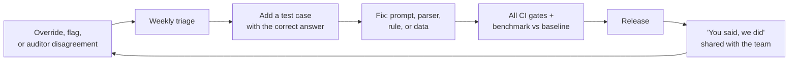

# Feedback loop for continuous improvement

Every correction a person makes is a free lesson. The loop turns them into tests, so the same mistake cannot come back.

## Where feedback comes from

| Source | What it tells us | How it is captured |
|---|---|---|
| **Overrides** (a reviewer approves an invoice the system held, with a reason) | A rule may be too strict, or a reading was wrong | Automatically: every override is in the audit log with the reason |
| **Rejections** | The system was right to hold it, or a real problem was found | Audit log |
| **"Flag this decision"** button (planned for the production review screen; not in the demo) | Anything that looks wrong or confusing | One click + a comment; goes to the triage list |
| **Weekly auditor sample** | Agreement and disagreements with the system | Internal Audit sheet, each disagreement with a cause |
| **Weekly 30-minute AP feedback session** | Usability, missing information, frustrations | AP Manager's notes |
| **Monthly Procurement report** | Recurring mismatch causes (wrong POs, vendor price drift) | Report from the decision log |
| **Monitoring** | Drift: grounding discards, unreadable invoices, fallback rate | Alerts (see [../deployment/observability.md](../deployment/observability.md)) |

## Triage (weekly, 30 minutes: AP Manager + AI owner)

Each item is classified and gets one owner:

| Category | Example | Fix | Owner |
|---|---|---|---|
| **Reading error** | Wrong total on a new vendor layout | Add the invoice (anonymized) to the test set; adjust prompt or parser | AI owner |
| **Rule too strict or too loose** | Freight cap outdated after a contract change | Proposal to Compliance; change rule or contract data | AP Manager → Compliance |
| **Data problem** | PO quantity wrong in the ERP | Procurement fixes the PO; root cause in the monthly report | Procurement |
| **Usability** | Reviewers want the contract link on the screen | Backlog item | Product / FDE team |
| **Not a problem** | The hold was correct | Explain; consider better wording | AP Manager |

## From feedback to a safe release

**Rule:** no fix is released without a test case that failed before the fix and passes after it. This is how the integration findings in this project were handled (for example, the empty-tax defaults in [../design/technology_choices.md](../design/technology_choices.md)).

## Targets for the loop itself

| Measure | Target |
|---|---|
| Time from a flagged reading error to a released fix | ≤ 2 weeks |
| Share of overrides with a usable reason | ≥ 95% (reasons are required by the system) |
| Golden set growth | ≥ 10 new real cases per month during the first 6 months |
| "You said, we did" items shared | Every week during pilot |
