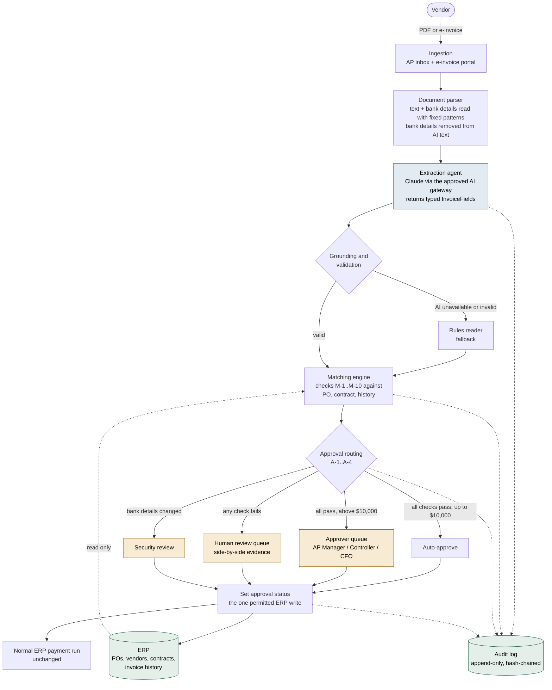
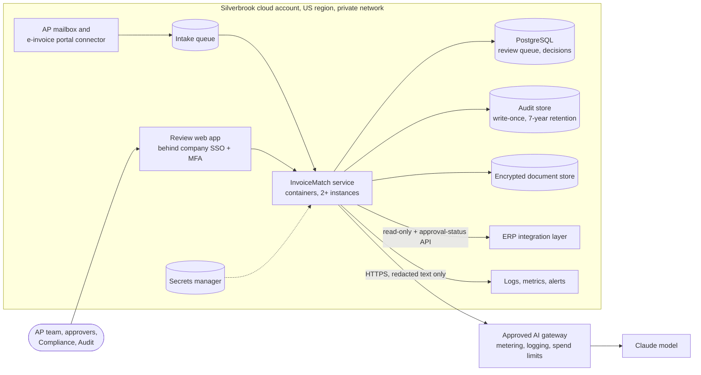

# Architecture

## Future state: the same process, with InvoiceMatch

Compare with [../discovery/current_state_workflow.md](../discovery/current_state_workflow.md). People now handle only the invoices that need judgment, with the evidence already assembled.

Blue: the only AI step. Amber: where people decide. Green: systems of record.

## Production deployment inside Silverbrook's cloud account

Everything runs in Silverbrook's own cloud account and region (non-negotiable N-1). The only traffic that leaves the private network is the AI call, which carries invoice text with bank details removed and goes through the company-approved AI gateway.

## What this repository implements

| Production component | This repository | Status |
|---|---|---|
| Ingestion (mailbox, e-invoice portal) | Sample invoice text files in `data/invoices/` and `data/holdout/` | Simulated |
| Document parser | [`src/invoicematch/parser.py`](../src/invoicematch/parser.py) | Implemented (text input; PDF-to-text in production) |
| Extraction agent | [`src/invoicematch/extraction.py`](../src/invoicematch/extraction.py), [`llm.py`](../src/invoicematch/llm.py), [`models.py`](../src/invoicematch/models.py) | Implemented, live through SharedLLM |
| Matching engine | [`src/invoicematch/matching.py`](../src/invoicematch/matching.py) | Implemented |
| Approval workflow | [`src/invoicematch/approvals.py`](../src/invoicematch/approvals.py), [`pipeline.py`](../src/invoicematch/pipeline.py) | Implemented, with role checks |
| Human review UI | [`web/`](../web) | Implemented (demo login: choose a persona) |
| Audit log | [`src/invoicematch/audit.py`](../src/invoicematch/audit.py) | Implemented (hash chain; in-memory or file) |
| ERP update | [`src/invoicematch/erp.py`](../src/invoicematch/erp.py) `set_approval_status()` | Simulated with a demo ERP |
| AI gateway | SharedLLM (the course gateway), Anthropic Messages endpoint | Live |

## Request flow for one invoice

1. **Parse**: normalize the text; read the bank account and routing number with fixed patterns; produce a copy of the text with them removed.
2. **Read**: send only the redacted text to Claude through the gateway, wrapped in `<invoice>` tags and marked as untrusted data. Ask for JSON matching `InvoiceFields`.
3. **Validate and ground**: validate the JSON against the schema; normalize dates, PO numbers, and currency; discard any invoice number, PO number, or total that is not printed in the text. If the AI fails or answers invalidly, the rules reader takes over.
4. **Match**: run checks M-1 to M-10 against the ERP data.
5. **Decide**: apply approval rules A-1 to A-4 with the configured limits.
6. **Record**: write the decision to the audit log; set the ERP approval status (approved, or on hold for a person).
7. **Human step** (if needed): an authorized role approves or rejects with a reason; logged; ERP status updated.
