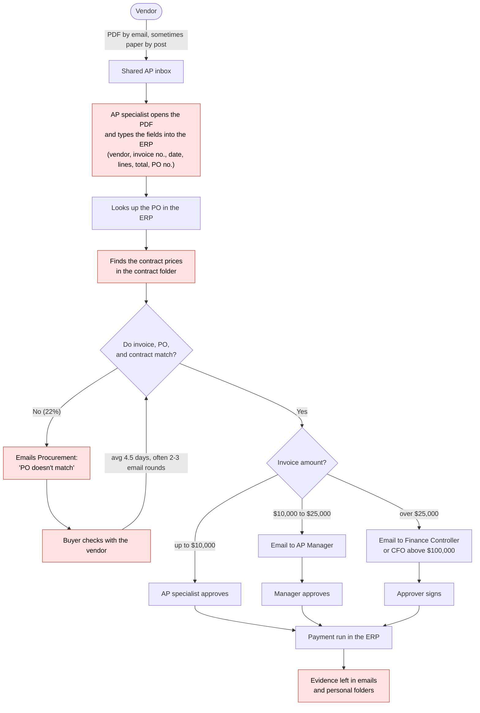

# Current-state workflow (today, before InvoiceMatch)

Observed by shadowing the AP team for two days and confirmed with the AP Manager. Numbers come from 3 months of ERP data (see [../scoping/business_case.md](../scoping/business_case.md)).

## Flow and handoffs

Red boxes are the main pain points.

## Data that moves between people

| From | To | What | How | Problem |
|---|---|---|---|---|
| Vendor | AP inbox | Invoice | PDF by email (82%), scanned paper (9%), e-invoice portal (9%) | Formats differ for every vendor |
| AP specialist | ERP | Invoice fields | Manual typing | Typing errors; about 8 minutes per invoice |
| Contract folder | AP specialist | Agreed prices and terms | Manual search | Often outdated copies; slow |
| AP specialist | Procurement | Mismatch question | Email | Vague; no exact difference stated |
| Procurement | Vendor | Correction request | Email or phone | Slow; 4.5 days on average |
| AP | Approvers | Approval request | Email | Evidence scattered; hard to audit |

## Measured pain points

| Pain point | Measurement (3-month ERP sample) |
|---|---|
| Manual typing and lookup | ~8 minutes per clean PO invoice |
| Exceptions | 22% of PO invoices; ~35 minutes of total handling each; 4.5 days to resolve |
| Duplicates and overpayments | $210,000 found by last year's audit; $90,000 recovered |
| Late payments | $38,000 in late-payment fees last year |
| Month-end backlog | Up to 600 invoices waiting; regular overtime |
| Audit evidence | 2–3 hours to rebuild the approval trail for one sampled invoice |
