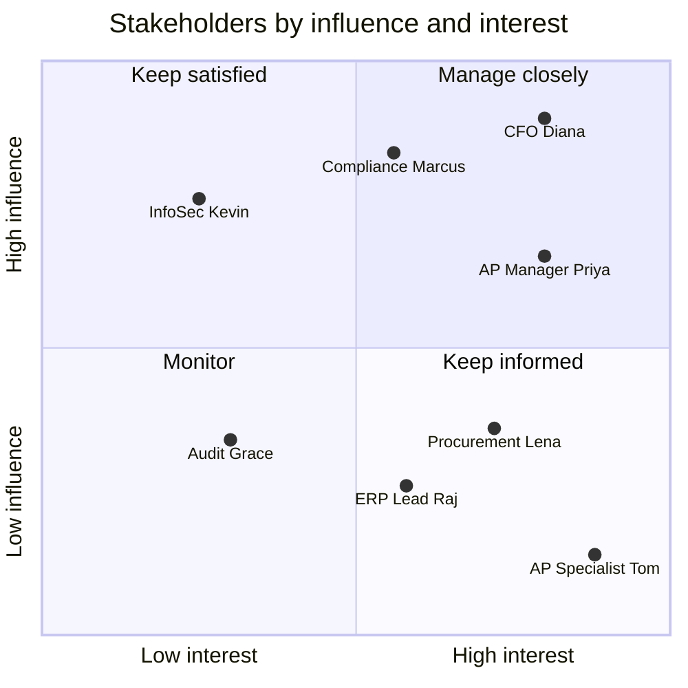

# Stakeholder map

All people are fictional. "Influence" is the power to approve, block, or shape the project. "Interest" is how much the outcome affects their daily work.

## Stakeholders

| Name | Role | Influence | Interest | What they want | Main concern | How we engage them |
|---|---|---|---|---|---|---|
| **Diana Reyes** | Chief Financial Officer (CFO), **executive sponsor** | High | High | Lower AP cost; absorb growth without new hires | "Will this pay back within a year?" | Monthly one-page update with the business metrics |
| **Marcus Oyelaran** | Chief Compliance Officer | High (**can veto**) | Medium | Auditability; SOX controls stay intact | "An AI approving payments we can't explain to an auditor" | Co-designs the decision rules and the audit log; signs off before go-live |
| **Priya Natarajan** | AP Operations Manager, **process owner** | Medium | High | A calmer month-end; fewer errors | "My team gets blamed for errors the tool makes" | Weekly working session; owns the pilot |
| **Tom Becker** | Senior AP Specialist (representing 6 specialists) | Low | High | Less copy-typing and email chasing | "Is this going to replace me?" | Early hands-on testing; feedback channel; pilot champion |
| **Lena Fischer** | Procurement Lead | Medium | Medium | Fewer "your PO is wrong" emails | "The tool will be used to police my buyers" | Mismatch reasons are written as neutral facts; shared weekly report |
| **Raj Malhotra** | ERP and Integration Lead (IT) | Medium | Medium | No risk to the ERP; standard integration | "Another system writing into the ERP" | Read-only ERP access plus one approved status-update API |
| **Kevin Osei** | Information Security Manager | High (**can block**) | Low | Data stays in the company's cloud; vendor risk reviewed | "Sending bank details to an outside AI model" | Security plan review; bank details are removed before any AI call |
| **Grace Liu** | Internal Audit Lead | Medium | Low | A sample-based way to check the system | "How do I test an AI?" | Defines the weekly auditor sample used as the quality metric |

## Influence / interest grid

| Quadrant | Who | Strategy |
|---|---|---|
| Manage closely | Diana (CFO), Marcus (Compliance), Priya (AP Manager) | Involve them in decisions; nothing ships without their sign-off |
| Keep satisfied | Kevin (InfoSec) | Early security review; no surprises |
| Keep informed | Tom (AP Specialists), Lena (Procurement), Raj (ERP) | Hands-on demos, regular updates, a clear feedback channel |
| Monitor | Grace (Internal Audit) | Agree the audit sample once, then share results monthly |

## Conflicts to manage

| Conflict | Between | Resolution in the scope |
|---|---|---|
| Speed of savings vs control | CFO vs Compliance | Start with a low auto-approval limit ($10,000) and raise it only on evidence from the auditor sample |
| Automation vs job security | CFO vs AP team | Position as capacity for 15% growth with no layoffs; staff move to exception resolution and vendor management |
| Strict matching vs friendly tone | Compliance vs Procurement | Rules stay strict; messages state facts ("invoice total is 7.8% above PO-7781"), never blame |
| Using AI vs data protection | Business vs InfoSec | AI only reads invoice text with bank details removed; data stays in the company's cloud region; calls go through an approved gateway |
